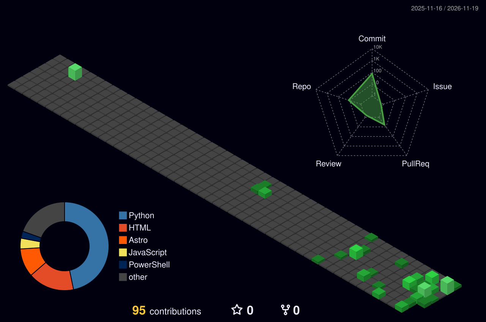

<h1>JIWOO HAN &nbsp;Aspiring Game Developer</h1>

Software Convergence student at Kyung Hee University, primarily studying game development with Unity and C#. 
Interested in gameplay programming, multiplayer game networking, game design, VFX, and game asset creation.

 

## 🛠️ Tech Stack

**Primary Focus**

**Other Game Engines**

**Other Languages**

**Art & VFX Tools**

**Development Tools & Web**

 

## 📊 Contribution

